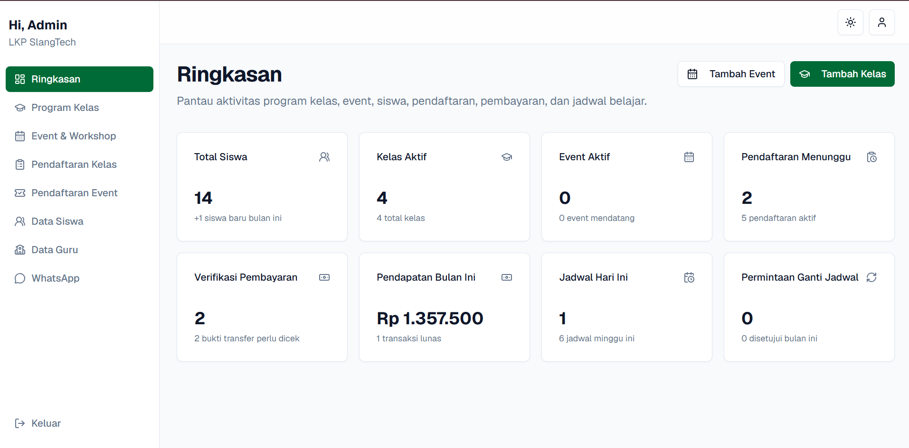

# LKP SlangTech - Admin Dashboard

Dashboard administrasi dan operasional internal untuk **LKP SlangTech** (`manage.slangtech.asia`). Sistem ini digunakan oleh admin dan pengelola untuk memverifikasi pendaftaran, mengelola kelas & event, mengatur jadwal pembelajaran, memonitor siswa/guru, serta mengelola integrasi WhatsApp Gateway.

---

## 🚀 Fitur Utama

- **Verifikasi Pendaftaran & Pembayaran**:
  - Peninjauan bukti transfer pendaftaran kelas dan event siswa.
  - Aksi **Setujui (Approve)** atau **Tolak (Reject)** pembayaran secara real-time.
  - **Otomasi Notifikasi Pasca-Verifikasi**:
    - Saat pembayaran disetujui, sistem secara otomatis mengirimkan **email konfirmasi** dan **pesan WhatsApp langsung ke nomor siswa**.
- **Penjadwalan & Reschedule**:
  - Penetapan jadwal kelas untuk pendaftaran siswa yang sudah aktif.
  - Penanganan permohonan penjadwalan ulang (*Reschedule Request*) dari siswa.
- **Manajemen Program & Konten**:
  - CRUD Kelas (Private & Group): pengaturan harga, diskon, silabus, dan gambar kurikulum.
  - CRUD Event (Webinar, Workshop): kuota peserta, tanggal mulai/selesai, trainer, dan harga.
- **Pusat Pengaturan WhatsApp Gateway**:
  - Konfigurasi bot gateway (Base URL, Bot Name `production`, API Key, Admin Phone) yang tersimpan secara terpusat di Firestore (`whatsappSettings/primary`).
  - Fitur pengujian kirim pesan WhatsApp (*Live Test*).
  - Monitoring log pesan WhatsApp masuk dan keluar (*Message Logs*).
- **Manajemen Pengguna Internal**:
  - Manajemen akun Administrator, Guru/Instruktur, dan database Siswa.

---

## 🛠️ Tech Stack

- **Framework**: [Next.js](https://nextjs.org/) 16 (App Router, Server Actions, Turbopack)
- **UI & Styling**: [React](https://react.dev/) 19, [Tailwind CSS](https://tailwindcss.com/) v4
- **Components & Design System**: Radix UI Primitives, Lucide Icons, Shadcn UI
- **Table & Charts**: TanStack Table & Recharts
- **Database**: Google Firebase Firestore Lite SDK (Node server-side & client-side)
- **Storage**: Cloudflare R2 (S3 SDK v3)
- **Email**: Native Node.js SMTP Client (`node:net` / `node:tls` Hostinger)
- **WhatsApp**: Baselab WA Gateway API Client

---

## 📁 Struktur Direktori

```text
dashboard/
├── app/                          # Next.js App Router
│   ├── api/                      # REST Endpoints (Auth, Upload, WhatsApp API)
│   ├── dashboard/                # Halaman-halaman panel admin
│   │   ├── classes/              # Manajemen kelas
│   │   ├── enrollments/          # Verifikasi pendaftaran & pembayaran kelas
│   │   ├── event-enrollments/    # Verifikasi pendaftaran event
│   │   ├── events/               # Manajemen event/workshop
│   │   ├── students/             # Data siswa
│   │   ├── teachers/             # Data pengajar
│   │   ├── whatsapp/             # Pengaturan WhatsApp Gateway
│   │   └── admins/               # Akun pengelola
│   └── login/                    # Autentikasi sesi admin
├── components/                   # Komponen UI umum (sidebar, header, modal, table)
├── features/                     # Domain modules
│   ├── classes/                  # Aksi & data kelas
│   ├── enrollments/              # Aksi verifikasi bayar, jadwal, reschedule
│   │   ├── payment-confirmation-whatsapp.ts # Notifikasi WA ke siswa
│   │   └── payment-confirmation-email.ts    # Notifikasi email ke siswa
│   ├── events/                   # Aksi & data event
│   └── whatsapp/                 # Komponen settings & tester WhatsApp
├── lib/                          # Library sistem
│   ├── auth/                     # Server-side auth verifikasi admin
│   ├── email/                    # Native SMTP client
│   ├── firebase/                 # Inisialisasi Firebase & Firestore
│   └── whatsapp/                 # WhatsApp API Client
└── public/                       # Aset statis & logo
```

---

## 💻 Panduan Menjalankan

### 1. Instalasi Dependensi
```bash
npm install
```

### 2. Mode Pengembangan (Development)
```bash
npm run dev
```
Dashboard berjalan di [http://localhost:3001](http://localhost:3001) (atau port default Next.js berikutnya).

### 3. Pengecekan Type & Test
```bash
npm run typecheck
npm run test
```

### 4. Kompilasi Produksi (Production Build)
```bash
npm run build
npm start
```
