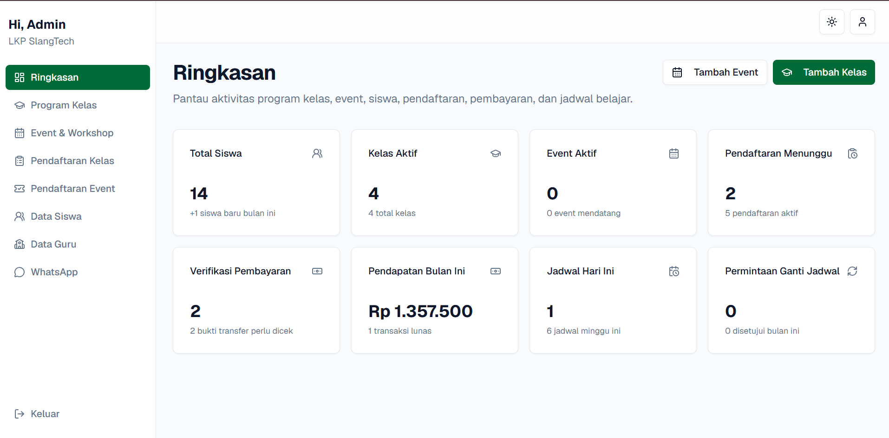
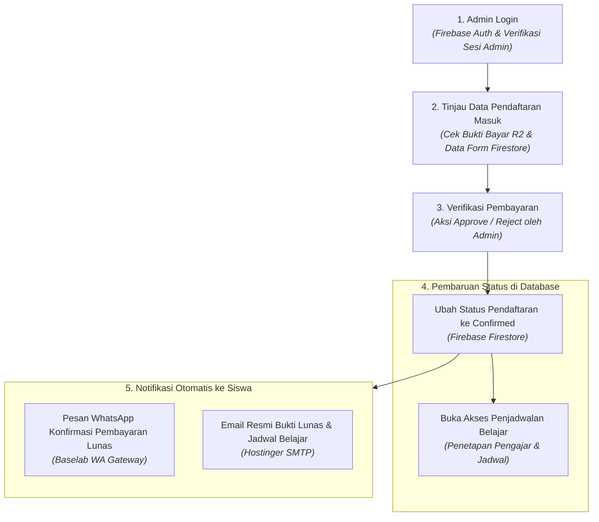
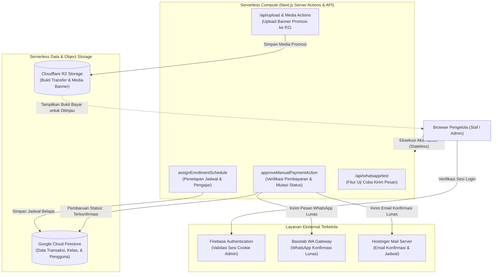

# LKP SlangTech - Admin Dashboard

Dashboard operasional dan manajemen internal untuk **LKP SlangTech** (`manage.slangtech.asia`). Sistem ini digunakan oleh admin dan pengelola untuk memverifikasi pendaftaran kursus, mengatur jadwal belajar, mengelola data kelas dan event, serta mengontrol integrasi WhatsApp Gateway.

---

## Fitur Utama

- Verifikasi Pendaftaran & Pembayaran:
  - Meninjau berkas bukti transfer pendaftaran kelas dan event siswa.
  - Aksi persetujuan (Approve) atau penolakan (Reject) bukti pembayaran secara langsung.
  - Otomasi pengiriman email konfirmasi dan pesan WhatsApp ke nomor siswa saat pembayaran disetujui.
- Pengaturan Jadwal Belajar:
  - Menetapkan jadwal kelas, memilih pengajar, dan mencantumkan tautan tatap muka (Google Meet / Zoom).
  - Meninjau dan menyetujui permohonan perubahan jadwal (*reschedule*) yang diajukan siswa.
- Pengelolaan Katalog Kelas & Event:
  - Menambah, mengubah, dan menonaktifkan program kelas privat maupun grup.
  - Mengatur jadwal event, kuota peserta, dan informasi narasumber/trainer.
- Pusat Pengaturan WhatsApp Gateway:
  - Konfigurasi terpusat bot WhatsApp (nama bot, API key, dan nomor admin).
  - Fitur uji coba kirim pesan WhatsApp (*Live Test*) dan pencatatan riwayat pesan.
- Manajemen Akun Pengguna:
  - Pengelolaan hak akses Administrator, data profil Pengajar/Guru, dan rekap data Siswa.

---

## Tech Stack

- Framework: [Next.js](https://nextjs.org/) 16 (App Router, Server Actions, Turbopack)
- UI Library: [React](https://react.dev/) 19 & [Tailwind CSS](https://tailwindcss.com/)
- Komponen & Ikon: Radix UI Primitives, Lucide Icons, Shadcn UI
- Tabel & Grafik: TanStack Table & Recharts
- Database: Google Cloud Firestore (REST API & Firestore SDK)
- Media Storage: Cloudflare R2 (S3 Client v3)
- Layanan Email: Hostinger SMTP Client
- WhatsApp Gateway: Baselab WA Gateway API

---

## Arsitektur Aplikasi End-to-End

Berikut alur verifikasi operasional dari sisi Admin Dashboard, mulai dari admin login hingga pengiriman konfirmasi kelulusan pembayaran ke siswa:



---

### Rincian Alur dan Komponen Dashboard

Penjelasan bagaimana bagian-bagian dalam dashboard bekerja secara berurutan:

#### 1. Panel Kendali Utama (`dashboard/app/dashboard`)
Halaman antarmuka yang digunakan staf admin untuk memonitor operasional harian:
- Ringkasan Dashboard: Grafik rekap pendaftaran, jumlah siswa aktif, dan total transaksi masuk.
- Menu Pendaftaran Kelas & Event (`/enrollments`, `/event-enrollments`): Daftar antrean pendaftaran baru yang menunggu pengecekan bukti transfer.
- Menu Program Belajar (`/classes`, `/events`): Formulir untuk menambah kelas baru, mengganti silabus, mengatur harga promo, dan merilis jadwal event.
- Menu Pengguna (`/students`, `/teachers`, `/admins`): Database profil siswa, penugasan instruktur, serta manajemen akun tim admin.
- Menu WhatsApp Gateway (`/whatsapp`): Panel uji coba pengiriman pesan dan konfigurasi nomor bot.

#### 2. Layanan Verifikasi Pendaftaran (`features/enrollments`)
Bagian inti yang memproses persetujuan atau penolakan transaksi:
1. Menampilkan rincian pendaftaran siswa beserta foto bukti transfer yang diambil dari Cloudflare R2.
2. Ketika admin menekan tombol "Setujui", sistem memperbarui status transaksi di Firestore dari "Menunggu Konfirmasi" menjadi "Terkonfirmasi" (*confirmed*).
3. Secara otomatis memicu pengiriman notifikasi WhatsApp ke nomor siswa yang terdaftar.
4. Mengirim surat elektronik konfirmasi pembayaran dan rincian kelas ke email siswa.

#### 3. Layanan Penjadwalan dan Pengajar (`features/teachers` & jadwal kelas)
Bagian yang mengatur jalannya proses belajar mengajar pasca-pembayaran disetujui:
- Admin menentukan instruktur yang bertugas, tanggal pertemuan, dan tautan kelas online (Google Meet atau Zoom).
- Menangani pengajuan jadwal ulang (*reschedule request*) jika siswa meminta pemindahan waktu sesi belajar.
- Memantau presensi dan kehadiran siswa per pertemuan.

#### 4. Pengaturan Komunikasi WhatsApp (`features/whatsapp` & `lib/whatsapp`)
Bagian pengatur koneksi perpesanan otomatis:
- Menyimpan kredensial API Baselab secara aman pada koleksi database `whatsappSettings/primary`.
- Memungkinkan admin menguji coba pengiriman pesan langsung dari dashboard tanpa harus membuka aplikasi luar.
- Menyediakan riwayat log pengiriman pesan untuk memastikan pesan konfirmasi sampai ke ponsel siswa.

---

### Pola Arsitektur Serverless

Aplikasi dashboard ini memanfaatkan ekosistem **Serverless** untuk menjaga keandalan dan keamanan data operasional:



1. **Next.js Server Actions & Route Handlers**:
   - Proses persetujuan pendaftaran, pengubahan jadwal, dan pengujian pesan WhatsApp dijalankan melalui *Server Actions* (`use server`) yang bersifat *stateless*.
   - Kredensial rahasia (seperti API key Baselab, password SMTP, dan Firebase Service Account) terlindungi di sisi server tanpa pernah terekspos ke browser pengguna.
2. **Basis Data & Cloud Storage Otomatis**:
   - Google Cloud Firestore mengelola pencatatan data dan status transaksi secara serverless dengan kapasitas yang menyesuaikan kebutuhan secara dinamis.
   - Cloudflare R2 menyajikan foto bukti bayar dan media promosi secara cepat melalui jaringan CDN global.
3. **Manfaat bagi Tim Operasional**:
   - **Sistem Selalu Siaga**: Dashboard dapat diakses 24/7 tanpa risiko server mati (*downtime*) akibat masalah perangkat keras lokal.
   - **Keamanan Terisolasi**: Setiap aksi admin dieksekusi dalam sesi terenkripsi dengan otorisasi berbasis hak akses peran (*Role-Based Access Control*).

---

### Integrasi API Eksternal

| Layanan | Endpoint / Protokol | Digunakan Pada | Fungsi |
| :--- | :--- | :--- | :--- |
| Google Firebase Authentication | `identitytoolkit.googleapis.com`<br/>`/v1/accounts:signInWithPassword` | `/login`, `/lib/auth/server.ts` | Autentikasi sesi login admin dan verifikasi hak akses sebelum membuka dashboard. |
| Google Cloud Firestore REST API | `firestore.googleapis.com`<br/>`/v1/projects/{PROJECT_ID}/...` | `features/enrollments`<br/>`features/classes`<br/>`features/events`<br/>`features/whatsapp` | Operasi persetujuan status pendaftaran, manajemen data kelas, pengajar, siswa, dan konfigurasi bot. |
| Cloudflare R2 Storage | `{ACCOUNT_ID}.r2.cloudflarestorage.com`<br/>`/{BUCKET_NAME}/*` | `/api/upload`, `features/media` | Memuat gambar bukti transfer siswa serta mengunggah gambar banner kelas dan event baru. |
| Baselab WhatsApp Gateway | `api-wa.baselab.web.id`<br/>`/api/send-message` | `features/enrollments`<br/>`/api/whatsapp/test` | Pengiriman pesan WhatsApp konfirmasi pembayaran lunas ke nomor siswa dan fitur live test admin. |
| Hostinger SMTP Mail Server | `smtp.hostinger.com`<br/>`Port 465 (SSL) / 587 (TLS)` | `features/enrollments/payment-confirmation-email.ts` | Pengiriman email konfirmasi lunas dan panduan kelas langsung ke alamat email siswa. |
| API Daerah Indonesia | `api-daerah-indonesia.vercel.app`<br/>`/api/...` | `/api/regions` | Menyediakan data master provinsi, kabupaten/kota, dan kecamatan saat melengkapi profil instruktur baru. |

---

## Struktur Direktori

```text
dashboard/
├── app/                          # Rute halaman Next.js App Router & API internal
│   ├── api/                      # Route Handlers serverless
│   │   ├── auth/                 # Penanganan sesi cookie admin
│   │   ├── regions/              # Proxy data master wilayah Indonesia
│   │   ├── upload/               # Upload media promosi ke Cloudflare R2
│   │   └── whatsapp/             # Endpoint pengujian & sinkronisasi bot WhatsApp
│   ├── dashboard/                # Halaman panel kendali admin
│   │   ├── admins/               # Pengaturan akun tim pengelola
│   │   ├── classes/              # Manajemen katalog kelas dan kurikulum
│   │   ├── enrollments/          # Verifikasi pendaftaran & pembayaran kelas
│   │   ├── event-enrollments/    # Verifikasi pendaftaran peserta event
│   │   ├── events/               # Manajemen kegiatan workshop & webinar
│   │   ├── students/             # Direktori data siswa terdaftar
│   │   ├── teachers/             # Manajemen akun dan profil pengajar
│   │   └── whatsapp/             # Pengaturan gateway & log pesan WhatsApp
│   └── login/                    # Halaman masuk untuk staf administrator
├── components/                   # Komponen visual umum (Sidebar, Header, Modal, Tabel)
├── features/                     # Modul logika bisnis per domain
│   ├── admins/                   # Validasi dan mutasi data admin
│   ├── classes/                  # Aksi pembuatan & pembaruan kelas
│   ├── enrollments/              # Aksi verifikasi pembayaran, notifikasi, dan jadwal
│   ├── events/                   # Aksi pembuatan event dan monitoring kuota
│   ├── teachers/                 # Penugasan jadwal dan data profil instruktur
│   └── whatsapp/                 # Layanan koneksi dan pengujian gateway WhatsApp
├── lib/                          # Pustaka utilitas dan klien pihak ketiga
│   ├── auth/                     # Pengecekan sesi admin di sisi server
│   ├── email/                    # Klien pengiriman email SMTP
│   ├── firebase/                 # Inisialisasi Firebase & koneksi Firestore
│   └── whatsapp/                 # Klien integrasi Baselab WhatsApp Gateway
└── public/                       # Berkas statis dan logo LKP SlangTech
```

---

## Panduan Menjalankan

### 1. Instalasi Dependensi
```bash
npm install
```

### 2. Mode Pengembangan (Development)
```bash
npm run dev
```
Dashboard berjalan di [http://localhost:3001](http://localhost:3001).

### 3. Pengecekan Type & Test
```bash
npm run typecheck
```
```bash
npm run test
```

### 4. Kompilasi Produksi (Production Build)
```bash
npm run build
```
```bash
npm start
```
